# Free(up)Mail

**Clear years of junk out of every inbox you own at once, without losing the emails that matter.**

Free(up)Mail reads all your mailboxes (Outlook, Gmail, Yahoo, iCloud, AOL or any other IMAP account) and groups everything by sender. It suggests what is junk and lets you decide. You can then clean up in one go, with a backup kept on your computer, and set your own rules so new mail is sorted automatically.

It is a small desktop app that **runs entirely on your computer**. There is no Free(up)Mail server, no account to create and no tracking, and it only does what you allow.

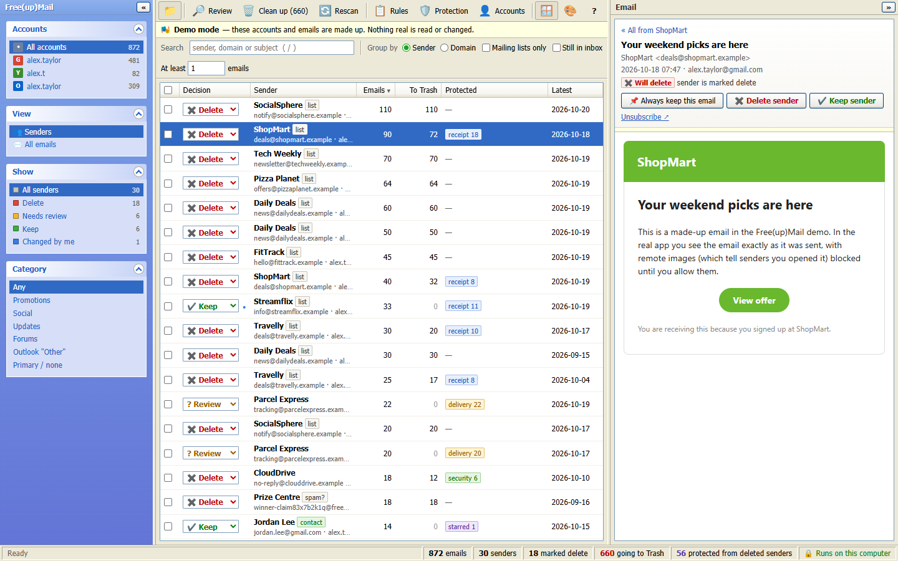

## Download

Get one file from the [latest release](https://github.com/MarkCockerill12/Free-up-Mail/releases/latest) and double-click it:

| File | Runs on | Needs |
| --- | --- | --- |
| `FreeUpMail-windows.exe` | Windows 10 / 11 | nothing |
| `FreeUpMail-macos` | macOS | nothing |
| `FreeUpMail-linux` | Linux | nothing |
| `FreeUpMail.pyz` | any of the above | [Python 3.11+](https://www.python.org/downloads/) |

Free(up)Mail opens in its own window, and closing the window stops it completely. On Windows and macOS this is a native window inside the app itself, drawn with the system's built-in web engine (WebView2 on Windows, WebKit on macOS). Nothing else opens: no browser, no browser profile and no extensions. It uses about 200 MB of memory. On Linux, or if that engine is missing, it opens in an Edge or Chrome app window instead, also without extensions, sync or sign-in.

The first time it runs, a welcome screen and a short guided tour show you around; you can open the tour again from the **?** button.

**First run on each system:**
- **Windows:** SmartScreen may warn about an unrecognised app because the exe isn't code-signed. Click **More info → Run anyway**.
- **macOS:** right-click the file and choose **Open**. If it is still blocked, run `xattr -d com.apple.quarantine FreeUpMail-macos` and then `chmod +x FreeUpMail-macos`.
- **Linux:** run `chmod +x FreeUpMail-linux`.

**Updates:** when it opens, Free(up)Mail asks GitHub whether a newer release exists (turn this off under **Protection**, or check any time from **? → Check for updates**). The standalone app updates itself: it downloads the new version, checks it is exactly the published file, swaps it in and restarts, and the old copy is deleted. The `.pyz` and source runs show you where to download it.

**Try it without connecting anything:** start it with `--demo` (for example `FreeUpMail-windows.exe --demo`). This opens made-up mailboxes, so you can explore every screen; nothing real is read or changed.

## How it works

1. **Connect your accounts** and choose what Free(up)Mail may do in each one. It starts by only listing your emails.
2. **Rescan.** It reads the sender, subject and date of every email (not the contents) and groups them by sender.
3. **Decide.** Every sender gets a suggestion: **Delete** for mailing lists and marketing, **Keep** for people you've emailed, and **Review** for anything unclear. You can change any decision, or go through them one by one in **Review** mode.
4. **Clean up.** Emails from senders marked Delete go to Trash. A copy of each one is saved on your computer first, so you can put any of them back later.
5. **Rules.** Send future mail wherever you want, either automatically after each scan or installed directly in Gmail or Outlook.

| | |
| --- | --- |
| 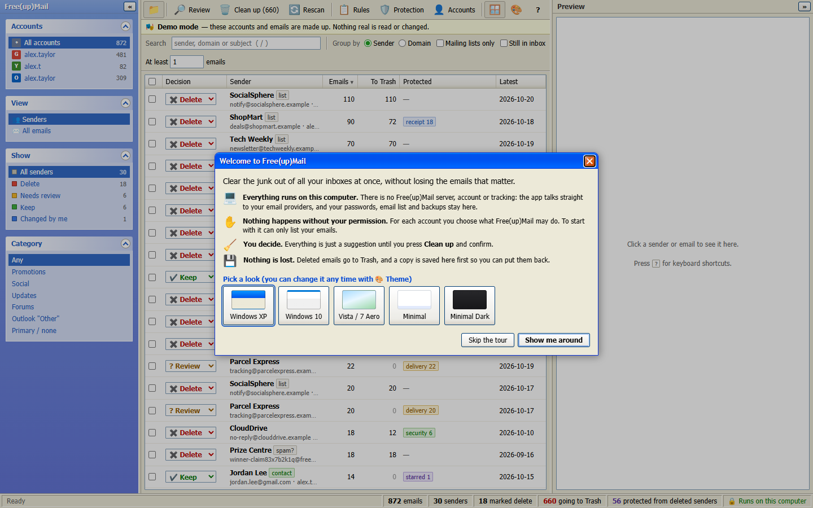 | 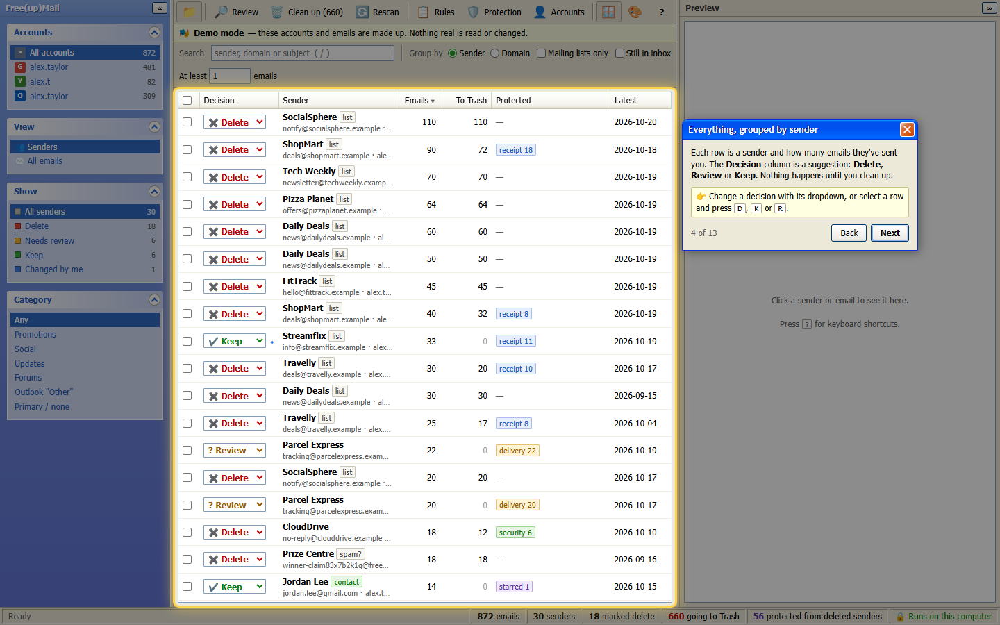 |
| **Welcome screen.** It explains up front that everything runs on your computer, then offers a tour. | **Guided tour.** It highlights each part of the window. Close it at any time, and find it again under **?**. |
| 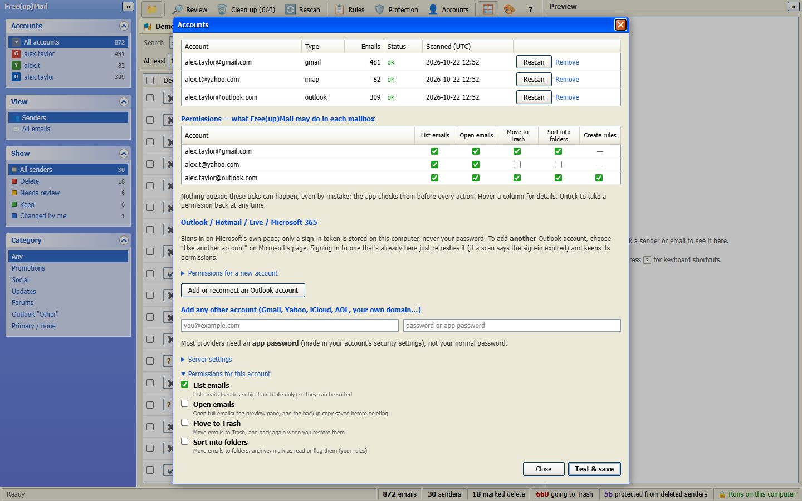 | 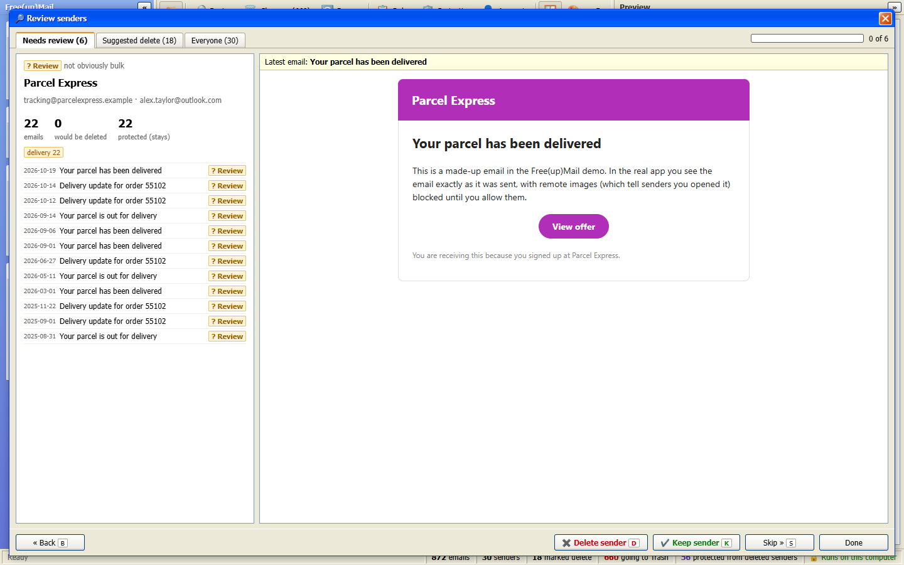 |
| **Permissions per account:** list, open, move to Trash, sort into folders, create server rules. | **Review mode:** one sender at a time, with their latest email beside it. Keys: D, K, S. |

## Rules: send email wherever you want

A rule has conditions and an action, like the filters in your email provider:

- **Conditions:** sender, sender's domain, subject (contains / doesn't contain / is / starts with / ends with), category (Promotions, Social, Updates…), type (receipt, security alert, delivery), mailing list, unread, starred, in the inbox, and age (older or newer than N days). A rule can require all of its conditions or any of them.
- **Actions:** move to a folder or label (created if it doesn't exist), archive, move to Junk/Spam, move to Trash, mark as read, flag/star, or **always keep**.
- **When rules run:**
  - **Preview** shows how many emails a rule matches before you run it.
  - **Run now** applies it to the emails already in your mailboxes.
  - Rules can also **run automatically after each scan**.
  - You can **install** rules in the mailbox itself, so new mail is sorted even when Free(up)Mail is closed:
    - Outlook: the rules are created for you.
    - Gmail: you get a filter file to import.
    - Other providers: you get a list of senders for their blocked list.

    Each rule shows a ✓ for Gmail and Outlook when it can be installed there.

| | |
| --- | --- |
| 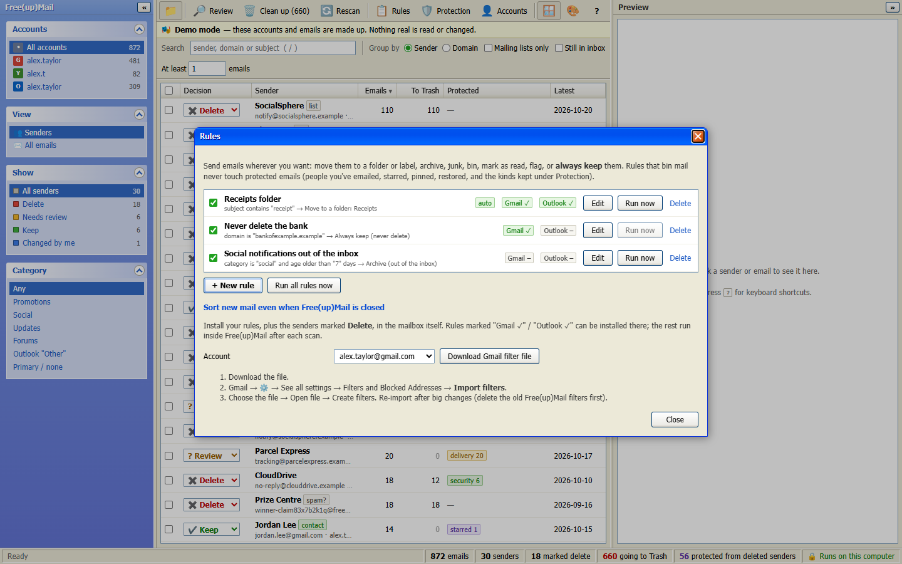 | 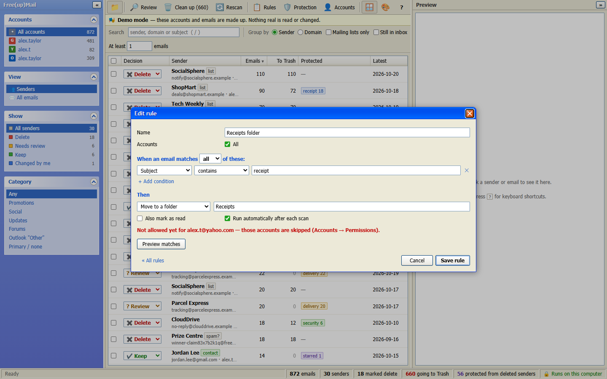 |

## Safety: nothing is lost, nothing happens without permission

- **Runs on your computer.** Free(up)Mail connects only to your email providers. Your passwords, sign-in tokens, the email list and the backups never leave your computer.
- **Permissions.** For each account you tick what Free(up)Mail may do:
  - list emails
  - open them
  - move them to Trash
  - sort them into folders
  - create server rules (Outlook only)

  Every action is checked against these ticks inside the app itself, not only by the buttons. An account starts with listing only.
- **Never deleted without your say-so.** Everything is a suggestion until you press **Clean up** and confirm. Even then, emails go to Trash; nothing is permanently deleted.
- **Backups.** Before an email is moved to Trash, a copy is saved on your computer as a standard `.eml` file. To get emails back, open **Deleted (restorable)** in the sidebar, then select emails and press **Restore**, or press **Restore all**. Emails still in Trash are moved back, and the rest are uploaded again from the backups, so this works even after the Trash has been emptied. Any mail app can also open the `.eml` files directly.
- **Backups are kept as long as you like.** Under **Protection → Keep backups for**, choose forever, 30 days, 90 days, 6 months or a year. Older copies are removed each time Free(up)Mail starts, so nothing needs to run in the background while it's closed.
- **Protected emails are never binned**, even if their sender is marked Delete or a rule says so:
  - people you've emailed
  - your own addresses
  - starred or flagged emails
  - emails you pinned or restored
  - "always keep" rules
  - security alerts, receipts and delivery updates (you choose which under **Protection**)
- **Re-checked before every move.** Each email is checked against the server just before it moves. If anything changed since the scan, the email is left alone.
- **Locked to its own window.** The app only answers requests that carry a secret key created each time it starts, so other programs and other users on the same computer can't read your mail through it.
- **No tracking pixels.** Remote images in emails stay blocked until you click to show them.

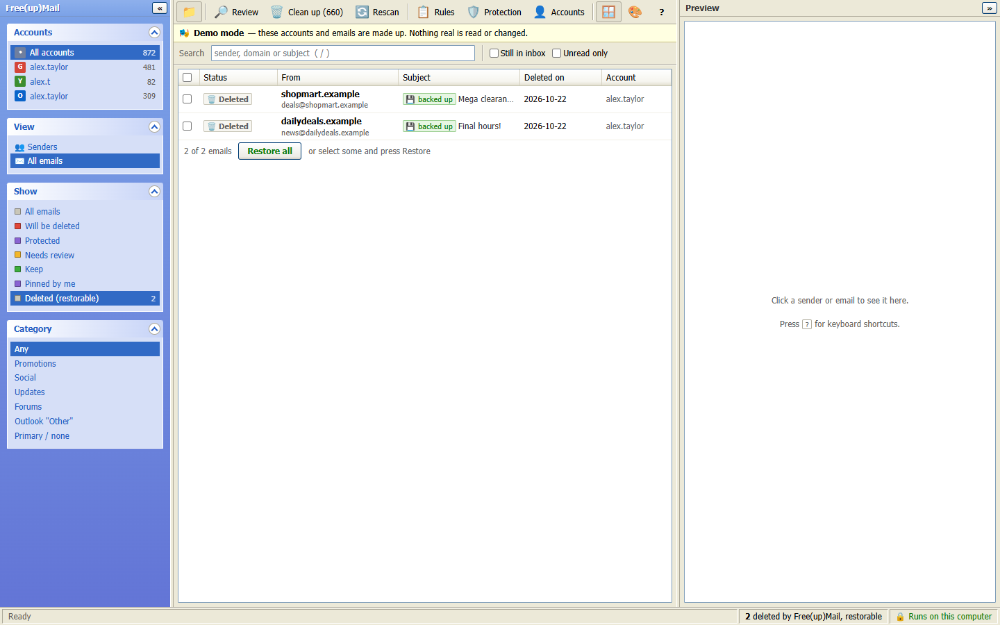

## Themes

Pick a theme on the welcome screen or with **🎨 Theme**: Windows XP, Windows 10, Vista / 7 Aero, Minimal or Minimal Dark. Drag the dividers to resize the side panes and double-click a divider to hide a pane. Drag the edge of a column heading to resize that column, and double-click it to reset. The window and panes fit themselves to your screen: on smaller screens the toolbar shows icons only. Free(up)Mail remembers your layout.

| | |
| --- | --- |
| 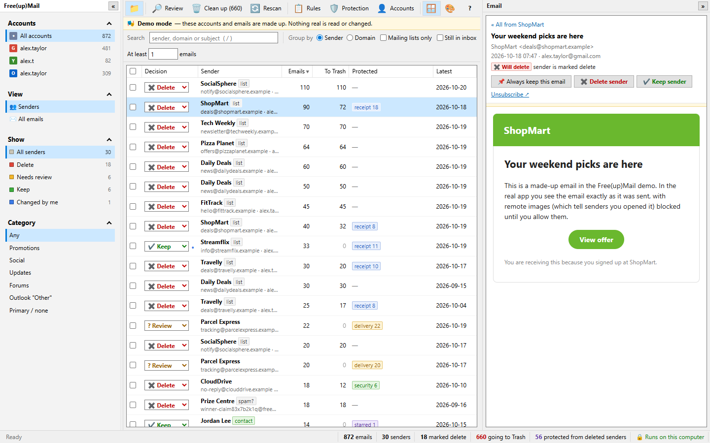 | 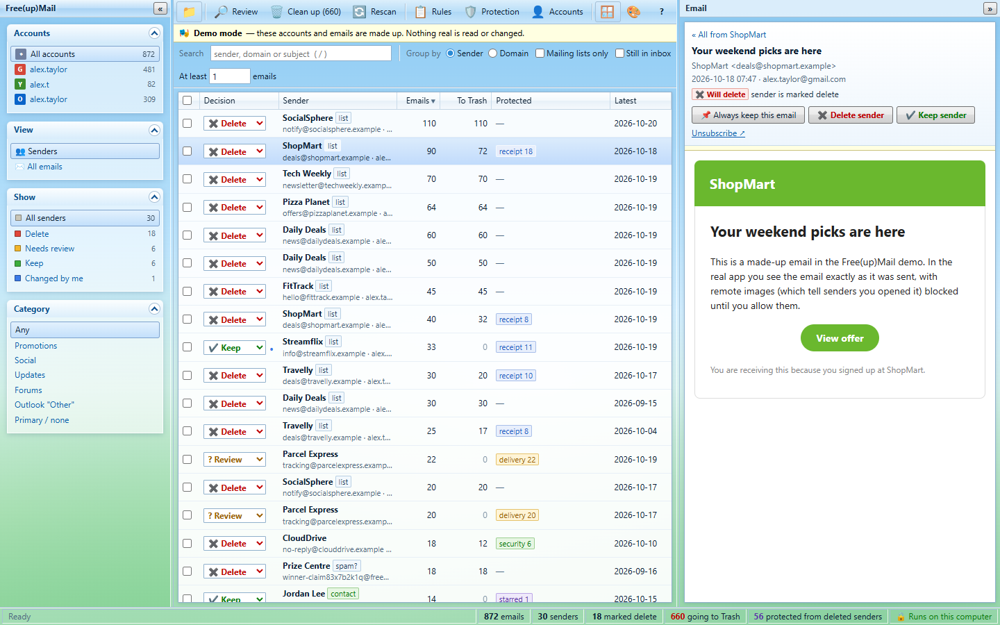 |
| **Windows 10** | **Vista / 7 Aero** |
| 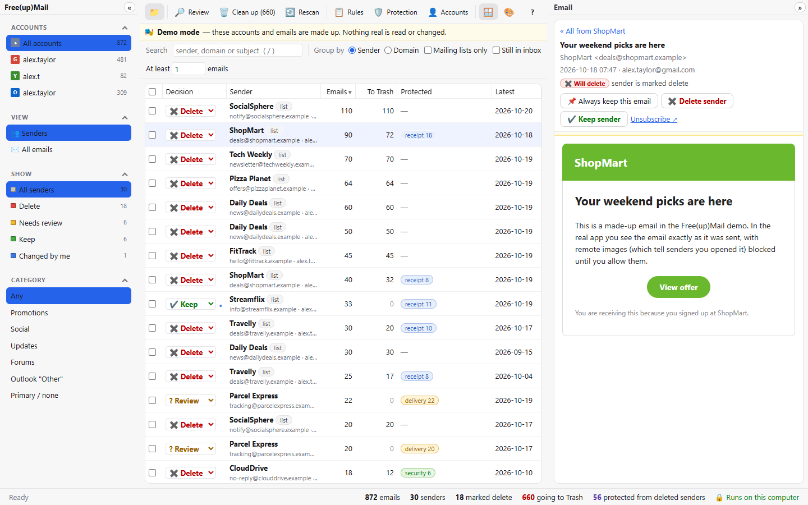 | 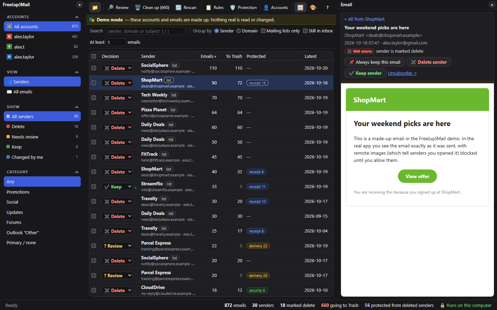 |
| **Minimal** | **Minimal Dark** |

## Connecting accounts

Open **Accounts** on the toolbar.

| Provider | How it connects |
| --- | --- |
| Outlook.com, Hotmail, Live, Microsoft 365 | **Connect Outlook**: sign in on Microsoft's own page with a one-time code. Only a sign-in token is stored, never your password. Add as many Outlook accounts as you like: choose "Use another account" on Microsoft's page. |
| Gmail / Google Workspace | Email + an [app password](https://myaccount.google.com/apppasswords) (2-Step Verification must be on). |
| Yahoo, iCloud, AOL, GMX, Zoho, Fastmail, Yandex… | Email + an app password from the provider's security settings. Free(up)Mail fills in the server automatically. |
| Anything else (your own domain, work mail…) | Email + password. If `imap.<your domain>` isn't the right server, enter it under **Server settings**. |

## Compared with other inbox cleaners

Services such as Clean Email, SaneBox, Leave Me Alone, Mailstrom and Unroll.me run on their own servers. They connect to your mailbox from there, most of them charge a subscription, and some fund themselves with data from your inbox. Free(up)Mail covers the core of what they do:
- bulk cleanup by sender
- rules for new mail
- unsubscribe links
- protection for important mail

It also adds things those services can't offer:

| | Free(up)Mail | Typical cloud inbox cleaner |
| --- | --- | --- |
| Where your mail is processed | On your computer | On the company's servers |
| Cost | Free | Usually a subscription |
| Rules for new mail | ✓ (and installable in Gmail / Outlook) | ✓ |
| Local backup of everything it deletes | ✓ | ✗ |
| Permission per action, per account | ✓ | Usually full access |
| Works with any IMAP mailbox | ✓ | Varies |

## Your data

Everything lives in one folder on your computer:

- Windows: `%LOCALAPPDATA%\FreeUpMail`
- macOS: `~/Library/Application Support/FreeUpMail`
- Linux: `~/.local/share/freeupmail`

To store it somewhere else, such as a USB stick, set the `FREEUPMAIL_HOME` environment variable.

What's in the folder:
- `accounts.json`: IMAP accounts and their app passwords.
- `outlook_tokens.json`: the Microsoft sign-in tokens, one per Outlook account.
- `mail.db`: the list of emails (headers only) and your decisions and rules.
- `backups/`: the `.eml` copies.

Passwords are stored the way most desktop mail clients store them, in a file only your user account can read. **Protection** shows how much space the backups use and can delete old ones. To remove an account, use **Accounts → Remove**, then revoke its app password with the provider. To remove Free(up)Mail completely, delete the folder.

## Running from source

The app uses only the Python standard library (3.11+), so there's nothing to install:

```
python -m freeupmail              # app window, quits when closed
python -m freeupmail --demo       # made-up mailboxes to try it out
python -m freeupmail --browser    # in your normal browser (Ctrl+C to stop)
```

On Windows, `FreeUpMail.bat` starts it without a console window. Running from source opens a browser app window unless you `pip install pywebview`, which switches it to the native window.

The tests use fake Gmail, IMAP and Outlook servers, so they never touch a real mailbox:

```
python -m tests.test_rules        # junk / receipt / security classification
python -m tests.test_automation   # rule matching and Gmail / Outlook translation
python -m tests.test_cleanup      # permissions, backups, cleanup, restore, rules
python -m tests.test_server       # the local server's key, host and port checks
python -m tests.test_safety       # changed emails, dropped connections, failed uploads
python -m tests.test_parallel     # big cleanups on several connections, two Outlook accounts
python -m tests.test_update       # the updater refuses a download that doesn't match the release
```

To build the single-file versions:

```
pip install pyinstaller
python build.py          # dist/FreeUpMail.pyz and dist/FreeUpMail(.exe)
```

Publishing a GitHub release runs `.github/workflows/release.yml`. It runs the tests, builds the Windows, macOS and Linux versions, and attaches them to the release. The release tag must match `__version__` in `freeupmail/__init__.py` (tag `v1.3.0` for `1.3.0`), or the build stops.

The icons use a small cut-down copy of [Noto Color Emoji](https://github.com/googlefonts/noto-emoji) (SIL Open Font License, `freeupmail/web/fonts/OFL.txt`), so they look the same on every computer.
